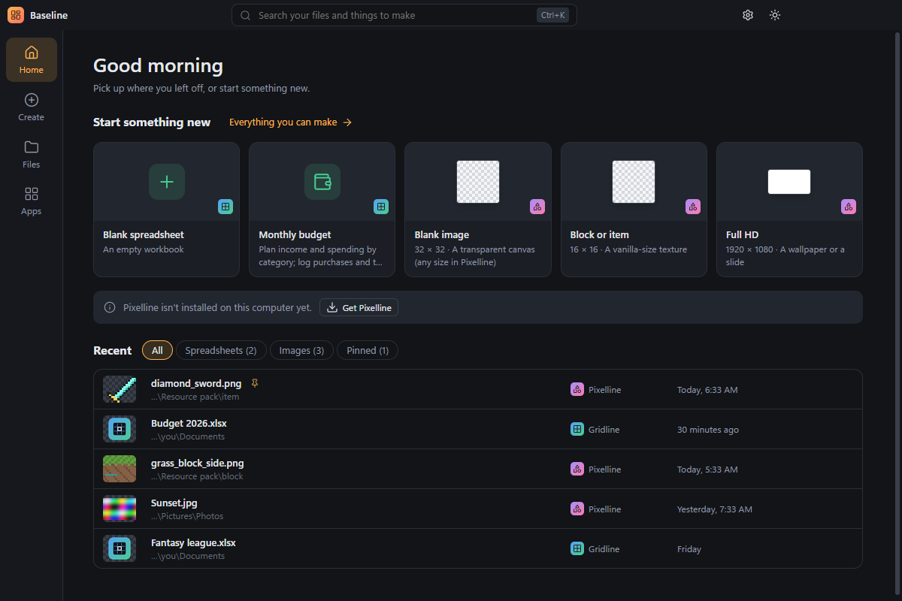

# Baseline

**The home for your apps.** Start a spreadsheet or an image, and pick up any file you worked on recently, from one window. Baseline opens [Gridline](https://github.com/LucasHeh47/gridline) (spreadsheets) and [Pixelline](https://github.com/LucasHeh47/pixelline) (images and pixel art). It's like the Microsoft 365 app, for this family of apps.

## What it does

- **Start something new** in one click: a blank spreadsheet or image, or a preset. There are Gridline's budget, loan, portfolio and sports presets, and Pixelline sizes for Minecraft textures, skins, sprites, icons and photos. **Create** lists them all.
- **Recent files from both apps** in one list, with pictures of your images. Filter by spreadsheets, images or pinned files, search with **Ctrl+K**, and pin the ones you use often. Click a file and it opens in the right app.
- **Open a file** (**Ctrl+O**): spreadsheets go to Gridline, images to Pixelline.
- **Apps** shows what's installed and its version, opens each app, and links to the download page for apps you don't have yet. Portable copies work too: tell Baseline where they are in **Settings → Apps**.
- Dark and light themes, optional start with Windows, and automatic updates (with a Developer branch for early builds), like the other apps.

Each app also has a switcher (the dotted button at the top left) to jump to the others.

## Download and install

1. Go to the **[releases](https://github.com/LucasHeh47/baseline/releases)**.
2. Download **`Baseline-Setup-x.y.z.exe`** (or the portable `Baseline-Portable-x.y.z.exe`) and run it.

Baseline doesn't open files itself, so install Gridline and/or Pixelline too.

> **"Windows protected your PC"?** Baseline isn't signed with a paid code-signing certificate, so Windows SmartScreen may warn you the first time. Click **More info**, then **Run anyway**.

## How it finds things

- **Apps:** each app notes where it runs from in a small shared file (`%APPDATA%\Baseline\suite.json`), and Baseline also looks where the installers put them (`%LOCALAPPDATA%\Programs\<App>\<App>.exe`).
- **Recent files:** Baseline reads the recent-file lists Gridline and Pixelline already keep. Pinning or removing a file in Baseline changes the same list, so the apps' own start pages agree.

Baseline doesn't collect analytics or send anything anywhere; it only checks this repository's releases for updates.

## Developing

See **[docs/development.md](docs/development.md)**.

## License

[MIT](LICENSE)
